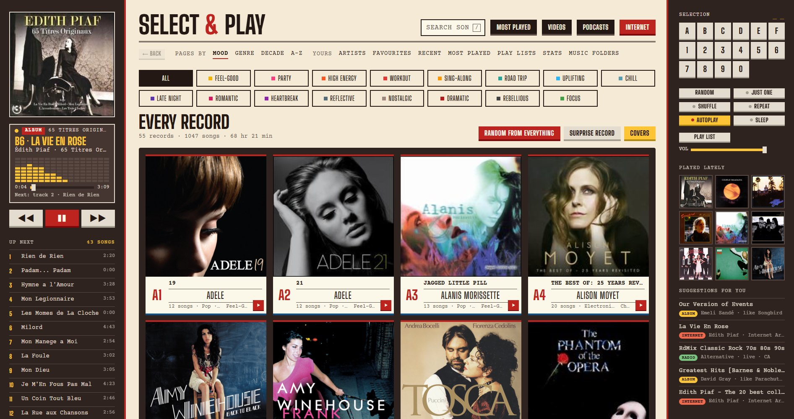

# Select & Play

A jukebox for your Windows PC. It plays the music already on your computer, plus internet radio, podcasts and free music from the Internet Archive. You pick records like on an old-fashioned wallbox: press a letter and a number (A1, B4…) and it plays.

## ⬇️ Download

### [**Click here to download Select & Play**](https://github.com/BrightonChappy/select-and-play-jukebox/releases/latest/download/Select-and-Play.zip)

Works on Windows 10 and Windows 11. Free.

---

## How to install (about 5 minutes)

1. **Click the download link above.** A file called `Select-and-Play.zip` goes into your **Downloads** folder.
2. **Open your Downloads folder.** Right-click `Select-and-Play.zip` and choose **Extract All…**, then press **Extract**.
3. A new folder opens. **Double-click `Install Select and Play`.**
4. Windows may show a blue box saying **"Windows protected your PC"**. That's normal for small free programs. Click **More info**, then **Run anyway**.
5. A black window opens and sets everything up on its own. It installs anything missing (Python and a few add-ons). **Leave it open until it says DONE.**
6. The jukebox opens. From now on it waits in the **tray** (the little icons by the clock) every time Windows starts. **Click its icon to open it.**

> Can't see the icon by the clock? Click the small **^** arrow next to the clock. Windows sometimes tucks new icons in there. You can drag it out onto the taskbar.

## The first time it opens

You get a short welcome screen:

1. **Name your jukebox.** Call it anything, like "Dave's Jukebox", or leave it as it is.
2. **Where is your music?** It looks in the usual places and shows what it finds, with the number of songs. Tick the folders you want. If your music is somewhere else (an external drive, say), press **Add another folder…** and pick it.
3. **Keep it all in one place?**
   - **Play my music where it is.** Nothing is copied or moved. Best for most people.
   - **Copy it all into one jukebox folder.** Good if your songs are spread across lots of folders. It copies everything into one tidy folder (sorted by artist and album). From then on, any new songs added to the ticked folders are copied over automatically. Your originals are never moved or deleted. It does use extra disk space.

Press **Start the jukebox**. You can change any of this later under **Music folders**.

## Using it

| To do this | Do this |
|---|---|
| Play a record | Press a letter, then a number, on the keys on the right (or your keyboard), e.g. **A** then **3** |
| Play something random | **Random** |
| Browse | **Pages by** Mood, Genre, Decade, or A–Z |
| Search your songs | The search box at the top (or press **/**) |
| Podcasts | **Podcasts** (or press **P**). Search for a show and press **+ Follow**. New episodes get a blue **New Episode** tag, and it suggests episodes you might like. |
| Internet radio and free music | **Internet** (or press **I**) |
| Favourites | The ♥ next to any song |
| Open it | Click the jukebox icon in the tray by the clock (or the desktop icon) |
| Hide it | Close the window with the **X**. The music keeps playing, and it goes back to the tray. |
| Quick controls | Right-click the tray icon: Play / Pause, Next, Previous |
| Turn it off completely | Right-click the tray icon and choose **Quit** |
| Stop it starting with Windows | Task Manager (Ctrl+Shift+Esc), then **Startup apps**, then right-click **Select & Play** and choose **Disable** |

Very big collections are fine. After record Z0 the codes carry on as AA1, AB1 and so on.

## Is this safe?

Yes. Here's how to tell:

- **Virus scans:**
  - **VirusTotal: 0 out of 93 security checkers flagged the download link.** [See the VirusTotal report](https://www.virustotal.com/gui/url/2b199ec1b01969f9ebb7a64eda0d5ad276c7af8ee214b82ed3b20490385529ac) (checked again for version 1.3.0 on 11 November 2026).
  - **Microsoft Defender** (the antivirus built into Windows) scanned the download on 11 November 2026, with up-to-date virus definitions, and found no threats.
  - You can run your own scan for free at [virustotal.com](https://www.virustotal.com).
- **Check you've got the real file:** the download's SHA-256 fingerprint is
  `566b13771b44fe6a5db158d7a7ec66cffec379646a5366b7f1e87bfb8eb7f6f4`.
  To check yours, right-click the Start button, open **Terminal** (or PowerShell), and type `Get-FileHash $HOME\Downloads\Select-and-Play.zip`. The long code it shows should match.
- **You can read every line.** Everything it runs is on this page in plain text: the installer is `install.ps1`, and the jukebox is in the `app` folder. There are no hidden programs inside.
- **What the installer adds:** Python (the free programming language, from python.org), six free add-ons (`mutagen`, `pywebview`, `pystray`, `imageio-ffmpeg` and `pillow`, plus `yt-dlp` for the Videos page), Microsoft's WebView2 if it's missing, and the jukebox itself. It doesn't need administrator access and doesn't change system settings.
- **Why Windows shows a warning:** Windows warns about any program that hasn't been downloaded by lots of people yet, or that hasn't been through Microsoft's paid signing. The warning isn't because anything harmful was found.
- **Your music is never changed, moved or deleted.** Uninstalling leaves your music exactly where it was.

## Updating

The jukebox tells you itself. About once a day it checks for a new version, and if there is one a bar appears at the top: **"New version available"**. Click **Update now**. A window opens for about a minute, then the jukebox restarts on the new version. Or click **Later**, and it won't ask again until the version after that.

You can also update at any time: open the Start menu and click **Update Select & Play**.

Your music, favourites, play lists and podcasts are always kept.

*(Installed before version 1.1? Then run the installer once more from the link above to get the automatic update alerts.)*

## Removing it

Open the Start menu and click **Uninstall Select & Play**. Your music files are never touched. It asks whether to keep your favourites and podcast list too.

## If something goes wrong

- **The installer says "Sorry, something went wrong".** Take a photo of the window and send it to whoever gave you the link. Usually the internet dropped out, so try running it again.
- **The jukebox window is blank.** Run the installer again. It fixes the missing Windows part (WebView2).
- **No music shows up.** Go to **Music folders** and tick the right folder, or use **Add another folder…**.
- **Some songs are missing.** It plays MP3, M4A, FLAC, OGG, WAV and WMA files. Songs from Spotify, Apple Music or other streaming apps can't be played, because those aren't files on your PC.
- **Windows Defender or antivirus complains.** The installer is a plain script you can read (`install.ps1`). It only installs Python, the add-ons listed in it, and the jukebox itself.

## What it connects to

Everything about you stays on your PC (in `%LOCALAPPDATA%\SelectAndPlay`). It only goes online for the features that need it:

- Apple's podcast directory, for searching podcasts. No Apple account is needed.
- The Internet Archive (archive.org), for free music.
- radio-browser.info, for radio stations.
- YouTube, only if you use the Videos page.

There are no accounts, no adverts and no tracking.

## For the curious

It's a small Python program (`app/server.py`) that serves a web page (`app/index.html`) in its own window (`app/tray.py`, using pywebview). The installer is `install.ps1`.
